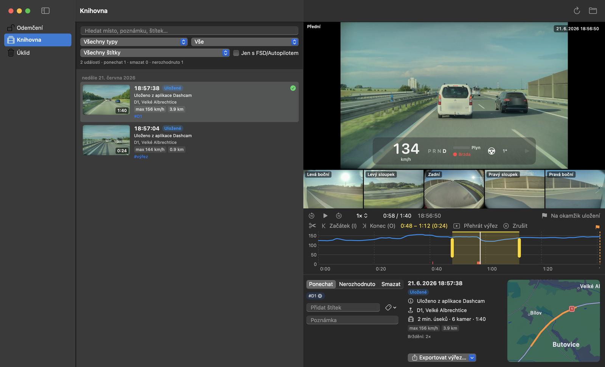
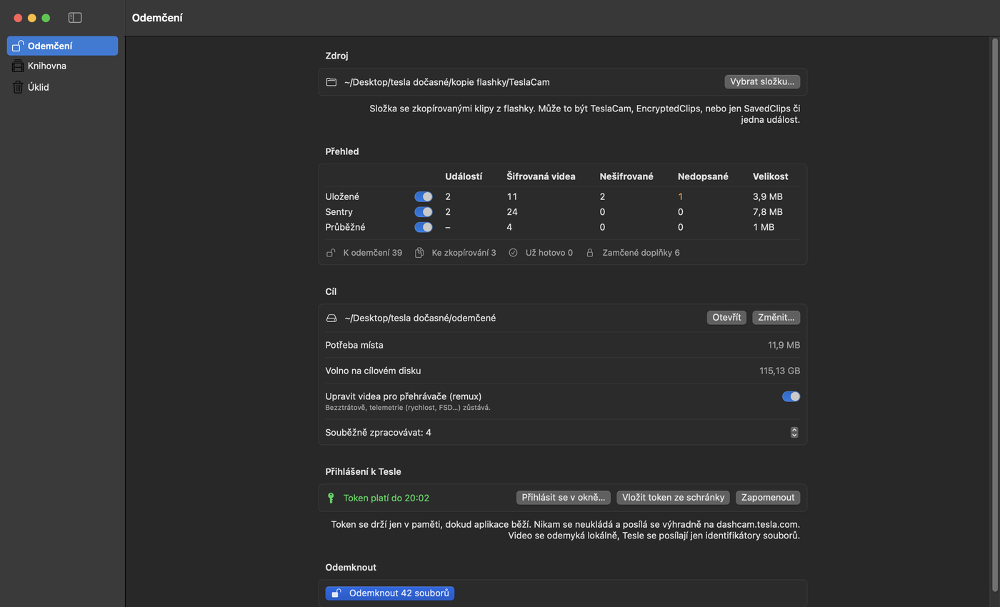
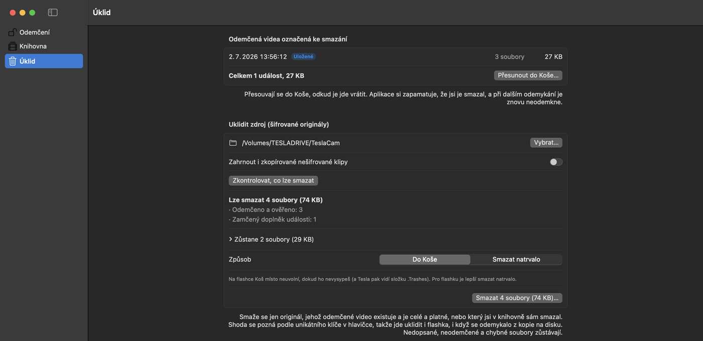
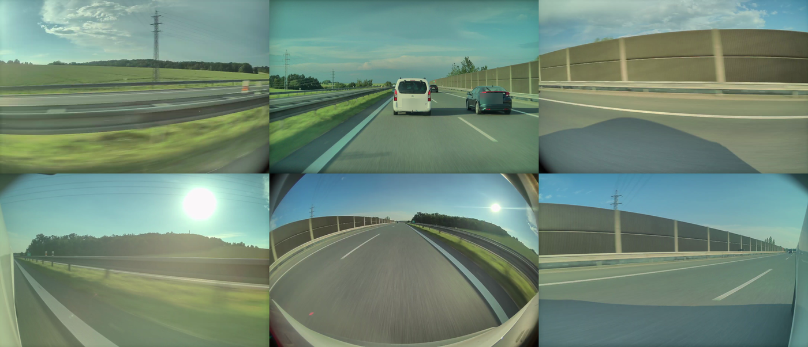
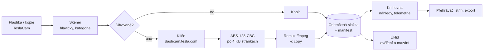

<div align="center">

# 🚗 Teslacam

**Odemkni, prohlédni, sestříhej a ukliď záznamy z Tesla dashcamu a Sentry – nativně na Macu.**




*Šest kamer naráz, rychlost, brzda a režim řízení přímo nad videem, graf jízdy, trasa na mapě a vyznačený výřez.*

</div>

---

## ✨ Co umí

| | |
|---|---|
| 🔓 **Odemčení šifrovaných klipů** | Firmware 2026.20+ ukládá klipy zašifrované. Teslacam si od `dashcam.tesla.com` vyžádá klíče a video odemkne **lokálně na Macu**. Paralelně, s průběhem, odhadem času a možností kdykoli navázat. |
| 🎬 **Přehrávač 6 kamer** | Přední, zadní, sloupky i boční kamery synchronně. Minutové soubory navazují bez mezer jako jedno video. Kliknutím zvětšíš libovolnou kameru. |
| 📈 **Telemetrie z auta** | Rychlost, plyn, brzda, natočení volantu, blinkry, převodový stupeň a **FSD / Autosteer / TACC** – Tesla je ukládá do každého snímku videa (firmware 2025.44.25+). |
| 🗺️ **Graf a mapa jízdy** | Graf rychlosti s barevně vyznačenými úseky FSD/Autopilota a brzděním, trasa z GPS na mapě. |
| ✂️ **Střih** | Klávesami **I** / **O** nebo tažením úchytů označíš úsek a uložíš ho jako novou událost – všechny kamery, bez ztráty kvality, i s telemetrií. |
| 📤 **Export** | Všechny kamery do složky, jen přední kamera, nebo mozaika 3×2 do jednoho videa (hardwarové kódování). |
| 🏷️ **Třídění** | Ponechat / smazat, štítky, poznámky, filtry podle typu, štítku nebo jízd s FSD, fulltextové hledání. |
| 🧹 **Bezpečný úklid** | Označené události do Koše. Šifrované originály ze zdroje nebo flashky smaže **jen po ověření**, že odemčené video je celé a platné, a vždy až po potvrzení se seznamem. |

---

## 📸 Ukázky

<table>
<tr>
<td width="50%"></td>
<td width="50%"></td>
</tr>
<tr>
<td><b>Odemčení</b> – přehled zdroje, kontrola volného místa, přihlášení k Tesle a odemknutí jedním tlačítkem.</td>
<td><b>Úklid</b> – co lze smazat a proč, co zůstane a proč. Nic se nemaže bez potvrzení.</td>
</tr>
</table>

<div align="center">


*Export mozaiky: sloupky a přední kamera nahoře, boční a zadní dole – jako v autě.*
</div>

---

## 🔐 Bezpečnost a soukromí

- **Video nikdy neopouští Mac.** Tesle se posílají jen identifikátory souborů a metadata z hlavičky (VIN, klíč zabalený autem), stejně jako to dělá oficiální prohlížeč.
- **Token jen v paměti.** Neukládá se na disk, do logů ani do Klíčenky; aplikace ho po vložení ze schránky smaže i ze schránky.
- **Jediná adresa:** token se posílá výhradně na `https://dashcam.tesla.com`, přesměrování jinam se odmítají.
- **Nic napůl:** soubory se zapisují přes dočasný soubor a přejmenují až hotové. Špatný klíč se pozná podle chybějícího `ftyp` boxu a výsledek se neuloží.
- **Nic se nemaže samo** a nic, co se neodemklo a neověřilo.

---

## ⚙️ Jak to funguje



Šifrovaný klip má dvě hlavičkové stránky (velikost, VIN, zabalený klíč, veřejný klíč auta) a za nimi AES-CBC payload po 4096 B; IV každé stránky je `MD5(MD5(klíč) + číslo stránky)`. Telemetrie je v H.264 SEI zprávách jako protobuf `SeiMetadata`.

---

## 🚀 Sestavení a spuštění

Potřeba: **macOS 14+**, **Xcode** a **ffmpeg**.

```bash
brew install ffmpeg
```

```bash
./scripts/build-app.sh
```

Aplikace vznikne v `build/Tesla Preview.app`. Testy spustíš příkazem `swift test`.

### Postup

1. Zkopíruj klipy z flashky na disk (nebo vyber přímo flashku).
2. **Odemčení** → vyber složku, přihlas se (vestavěné okno nebo token ze schránky) a odemkni.
3. **Knihovna** → prohlížej, označuj, stříhej, exportuj.
4. **Úklid** → smaž nepotřebné a uvolni flashku.

<details>
<summary><b>Jak získat token ručně</b></summary>

1. Přihlas se na <https://dashcam.tesla.com>.
2. Otevři vývojářské nástroje (⌘⌥I) → záložka **Network**.
3. Přetáhni na stránku libovolný šifrovaný klip.
4. Otevři požadavek `batch` a zkopíruj hodnotu za `Authorization: Bearer ` (začíná `eyJ`).
5. V aplikaci klikni na **Vložit token ze schránky**.

</details>

---

## 🗂️ Struktura projektu

```
Sources/TeslaCamCore   kontejner a dešifrování, Tesla API, skener, odemykání,
                       MP4 parser, telemetrie, knihovna, indexace, export, úklid
Sources/TeslaPreview   SwiftUI aplikace
Tests/                 testy jádra (vlastní šifrované vzorky, skutečné H.264 přes ffmpeg)
```

Ve složce odemčených videí vzniká `.tesla-preview/` s manifestem odemčení, označením událostí a mezipamětí náhledů a telemetrie.

## 🙏 Poděkování

- Formát kontejneru a postup odemykání podle [tesla-dashcam-decrypt-go](https://github.com/crstian19/tesla-dashcam-decrypt-go) (MIT); testovací vzorek `real_clip.*` pochází odtud.
- Formát telemetrie podle oficiálního [teslamotors/dashcam](https://github.com/teslamotors/dashcam).

<sub>Neoficiální projekt, nijak nespojený se společností Tesla. SPZ ve screenshotech jsou rozmazané.</sub>
